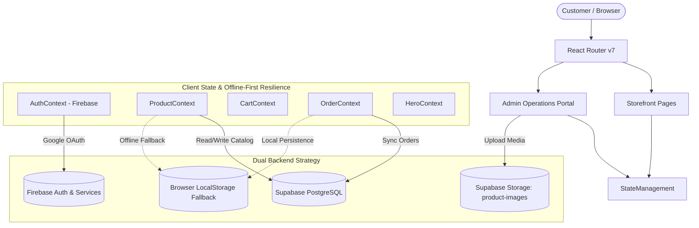

# 🥿 Desi-Kicks | Heritage Craft Meets Modern Footwear

[](https://react.dev/)
[](https://www.typescriptlang.org/)
[](https://vitejs.dev/)
[](https://tailwindcss.com/)
[](https://supabase.com/)
[](https://firebase.google.com/)
[](https://www.docker.com/)
[](LICENSE)
[](#-production-roadmap)

**Desi-Kicks** (also operating under the brand **CraftYourSole**) is an omnichannel direct-to-consumer (D2C) e-commerce footwear platform designed to unite authentic Indian artisan shoemaking with modern ergonomic foot mechanics.

From royal velvet Zari-embroidered mojaris and Agra full-grain leather loafers to breathable 3D AirKnit daily slip-ons, contoured botanical cork slides, and playground-ready kids' sneakers, Desi-Kicks delivers authentic design with cloud-like comfort across all 19,000+ Indian postal codes.

---

## 📑 Table of Contents

- [Key Features](#-key-features)
  - [Storefront & Discovery](#storefront--discovery)
  - [Curated Collection Showcases](#curated-collection-showcases)
  - [Product Experience & Sizing Matrix](#product-experience--sizing-matrix)
  - [Cart, Pricing & Checkout](#cart-pricing--checkout)
  - [Customer Account & Self-Serve Hub](#customer-account--self-serve-hub)
  - [Admin Operations Portal (`/admin/*`)](#admin-operations-portal-admin)
  - [Algorithmic Best Seller Engine](#algorithmic-best-seller-engine)
- [System Architecture](#-system-architecture)
  - [Tech Stack](#tech-stack)
  - [Data Flow & Fallback Architecture](#data-flow--fallback-architecture)
- [Directory Structure](#-directory-structure)
- [Database & Storage (Supabase)](#-database--storage-supabase)
- [Getting Started](#-getting-started)
  - [Prerequisites](#prerequisites)
  - [Environment Configuration](#environment-configuration)
  - [Installation & Local Development](#installation--local-development)
  - [Building for Production](#building-for-production)
  - [Code Quality & Linting](#code-quality--linting)
- [Deployment Guide](#-deployment-guide)
  - [Docker & Containerization](#docker--containerization)
  - [Google Cloud Run & Cloud Build](#google-cloud-run--cloud-build)
  - [Firebase Hosting & Netlify](#firebase-hosting--netlify)
- [Production Roadmap](#-production-roadmap)
- [Contributing](#-contributing)
- [License](#-license)

---

## ✨ Key Features

### Storefront & Discovery
- **Seamless Infinite Hero Carousel**: Touch-gesture-enabled infinite queue carousel with seamless snap looping, dual-orientation art direction (16:9 widescreen landscape for desktop & 9:16 vertical portrait for mobile), pause-on-hover, and CTA banner linking.
- **Gender Selection Posters**: Dedicated 3-column curated poster grid (`GenderSelection.tsx`) in 4:5 portrait aspect ratio featuring Men, Women, and Kids collections with studio imagery and direct collection routing.
- **Curated Multi-Faceted Collections**: Dynamic collection pages supporting filtering across subcategories, target gender, UK sizing, live stock availability, price range brackets, and sorting (Featured, Price Low-to-High, Price High-to-Low, Top Customer Rating).
- **Instant Search with Autocomplete**: Multi-device predictive search dropdown highlighting trending searches, tag suggestions, and direct SKU routing.
- **SEO & Social Share Ready**: Automated dynamic XML sitemap generation (`scripts/generate-sitemap.mjs`), Open Graph / Twitter Card tags, and canonical URL synchronization (`SeoHead.tsx`).
- **Trust & Assurance Badges**: Transparent value propositions—Free Pan-India Delivery above ₹1,999, 7-Day Hassle-Free Size Exchange, Handcrafted Authenticity, and Dedicated WhatsApp Support.

### Curated Collection Showcases
- **Men's Showcase (`MenCollectionShowcase.tsx`)**: Dedicated promotional banner slider with auto-advance, touch swipe, and a category quick-scroll carousel covering Casual Loafers, Rain-Ready Clogs, Contoured Slides, Casual Sneakers, and Agra Formals.
- **Women's Showcase (`WomensCollection.tsx`)**: "Nature in Every Step" editorial banner paired with curated pastel retro sneakers, botanical cork slides, and block heels.

### Product Experience & Sizing Matrix
- **Dual Presentation**: Zero-reload quick-view modal (`ProductDetailModal.tsx`) for fast browsing and dedicated deep-linkable product detail pages (`/products/:slug`).
- **Multi-Angle Gallery**: High-resolution photography gallery supporting up to 5 multi-angle studio shots per SKU.
- **Artisan Stories & Technical Specifications**: Transparent breakdowns of upper materials (full-grain leather, breathable 3D AirKnit, royal velvet), sole engineering (buff-tanned leather, EVA flex, anti-skid TPR), and insole cushioning (dual-density orthopedic memory foam).
- **Interactive UK 1–12 Sizing Matrix**: Real-time stock validation across variants; displays instant low-stock indicators (`Only X pairs left!`) and disables out-of-stock sizes.

### Cart, Pricing & Checkout
- **Resilient Cart State**: Automatic synchronization between React Context and `localStorage`, handling product variants, sizes, and quantity limits.
- **Dynamic Pricing Engine**: Real-time calculation of MRP, catalog discount savings, free delivery eligibility (orders ₹1,999+), optional shoe care kit add-ons, and coupon discounts.
- **Promotional Coupon Engine**: Instant validation for promotional codes (`FESTIVE20`, `DIWALI500`, `WELCOME10`, `SOLEFIRST`) with minimum order value rules.
- **Indian Postal & Address Form**: Comprehensive address form collecting customer name, phone number, street address, city, state, and 6-digit Indian PIN code.
- **Flexible Payment Methods**: Support for UPI, Credit/Debit Cards, NetBanking, and Cash on Delivery (COD).

### Customer Account & Self-Serve Hub
- **Firebase Google OAuth**: 1-click Google authentication with session persistence.
- **Live Order Timeline**: Real-time tracking of order states (`Pending` → `Packing` → `Shipped` → `Delivered`).
- **Self-Serve Size Exchange**: Customers can request replacement sizes or report fit issues directly from their order history without contacting support.
- **Printable GST Tax Invoices**: Dynamic, print-optimized tax invoices complete with HSN codes, SAC identifiers, SGST/CGST breakdowns, and order timestamps.

### Admin Operations Portal (`/admin/*`)
- **Protected Operations Access**: Dedicated administrator authentication credentials decoupled from customer accounts.
- **Executive Analytics Dashboard**: Real-time gross merchandise value (GMV), total order counts, average order value (AOV), fulfillment status pipelines, trailing 7-day revenue visualization, and top-selling SKUs.
- **Product Catalog Management**: Full CRUD operations for products—custom slugs, pricing, artisan stories, taxonomy categories/subcategories, target gender, tags, and 5-angle image URLs.
- **Granular Variant Inventory Management**: Add, update, and manage individual size inventory levels (UK 1 to UK 12) with visual low-stock warning pills (`stock <= 5`).
- **Direct Image Uploads (`ImageUploadField.tsx`)**: Drag-and-drop file upload with automated upload to Supabase Storage bucket (`product-images`) and instant preview.
- **Hero Banner CMS (`BannersSection.tsx`)**: Manage homepage hero slides—add, edit, toggle active status, adjust transition orders, and configure desktop/mobile image assets.
- **Order Fulfillment Workflow**: Transition order states, view customer shipping details, load simulated test orders, and manage order logs.

### Algorithmic Best Seller Engine
Rather than arbitrary merchant placement, the storefront's Best Seller shelf utilizes an objective 4-pillar scoring algorithm (`bestSellerAlgorithm.ts`):

$$\text{Score} = \frac{W_{\text{sales}} \cdot S_{\text{sales}} + W_{\text{rating}} \cdot S_{\text{rating}} + W_{\text{stock}} \cdot S_{\text{stock}} + W_{\text{boost}} \cdot S_{\text{boost}}}{\sum W}$$

1. **Sales Volume ($W = 0.45$)**: Normalized verified sales units against the highest-selling catalog item.
2. **Bayesian Review Confidence ($W = 0.25$)**: Normalizes star rating scaled logarithmically by verified review count, preventing 1-review 5-star items from eclipsing battle-tested 4.8-star shoes with hundreds of reviews.
3. **Inventory Availability ($W = 0.15$)**: Penalizes sold-out items to 0 and de-weights near-stockout items ($1 \le \text{stock} \le 5$) so customers aren't recommended dead ends.
4. **Merchandising Tag ($W = 0.15$)**: Grants priority to curated seasonal picks (e.g., *Festive Edit*, *Trending*, *Signature*).

---

## 🏗️ System Architecture

### Tech Stack

| Layer | Technologies |
| :--- | :--- |
| **Frontend Framework** | [React 19](https://react.dev/) + [TypeScript 6](https://www.typescriptlang.org/) |
| **Build Tool & Bundler** | [Vite 5.4](https://vitejs.dev/) with Rollup Manual Chunk Splitting |
| **Styling & Design** | [Tailwind CSS v4](https://tailwindcss.com/) with `@tailwindcss/vite` |
| **Routing** | [React Router v7](https://reactrouter.com/) (Code-split admin portal) |
| **Relational Database** | [Supabase](https://supabase.com/) (PostgreSQL 15 with Row Level Security) |
| **Storage Bucket** | Supabase Storage (`product-images` public bucket) |
| **Authentication** | [Firebase Auth](https://firebase.google.com/) (Google OAuth) + Custom Admin Gate |
| **Production Server** | [Nginx Alpine](https://nginx.org/) with Gzip & Security Headers |
| **Container & Cloud** | [Docker](https://www.docker.com/) + [Google Cloud Run](https://cloud.google.com/run) via Cloud Build |

### Data Flow & Fallback Architecture



---

## 📁 Directory Structure

```text
Desi-Kicks/
├── .github/                     # GitHub workflows and automation
├── public/                      # Static assets, favicon, generated sitemap.xml
├── scripts/
│   └── generate-sitemap.mjs     # Dynamic XML sitemap generation script
├── src/
│   ├── assets/                  # High-res photography, hero posters, brand logo
│   │   ├── hero/                # Desktop & mobile hero banners & category references
│   │   └── craftyoursole_logo.svg
│   ├── components/              # Reusable UI & business presentation components
│   │   ├── ui/                  # Primitives (Icon.tsx, Dropdown.tsx)
│   │   ├── Hero.tsx             # Infinite responsive hero carousel
│   │   ├── Navbar.tsx           # Navigation header, search trigger & badges
│   │   ├── BottomNav.tsx        # Mobile persistent navigation bar
│   │   ├── Footer.tsx           # Footwear links, newsletter, policy anchors
│   │   ├── BestSellers.tsx      # Algorithmic best sellers shelf
│   │   ├── MenCollectionShowcase.tsx # Men's promotional banner & categories
│   │   ├── WomensCollection.tsx # Women's editorial showcase
│   │   ├── GenderSelection.tsx  # 3-column curated gender poster cards
│   │   ├── ProductCard.tsx      # Footwear card with size badges & pricing
│   │   ├── ProductDetailModal.tsx # Quick-view modal with size selection
│   │   ├── MobileSearch.tsx     # Fullscreen mobile search interface
│   │   ├── SeoHead.tsx          # Dynamic SEO meta tags and social graph
│   │   └── TrustBadges.tsx      # Delivery, exchange & authentic craft guarantees
│   ├── constants/               # Domain models, initial catalog & site metadata
│   │   ├── site.ts              # Collections metadata, SEO titles & brand info
│   │   ├── taxonomy.ts          # Footwear categories, subcategories & sizes
│   │   ├── productCatalog.ts    # Seed product catalog
│   │   ├── productReviews.ts    # Customer feedback & reviews
│   │   └── search.ts            # Search keywords & suggestions
│   ├── context/                 # Application state providers
│   │   ├── AuthContext.tsx      # Firebase Google authentication
│   │   ├── ProductContext.tsx   # Product catalog sync & stock validation
│   │   ├── CartContext.tsx      # Cart items, pricing & localStorage persistence
│   │   ├── OrderContext.tsx     # Order processing & business metrics
│   │   ├── HeroContext.tsx      # Dynamic banner state & order
│   │   ├── WishlistContext.tsx  # Customer wishlist state
│   │   └── ProductModalContext.tsx # Global product quick-view modal state
│   ├── hooks/                   # Custom React hooks (useTypingEffect, etc.)
│   ├── lib/                     # Third-party service clients & mathematical algorithms
│   │   ├── supabase.ts          # Supabase client & query handlers
│   │   ├── firebase.ts          # Firebase app initialization & auth
│   │   └── bestSellerAlgorithm.ts # 4-pillar objective ranking algorithm
│   ├── routes/                  # Routed page views
│   │   ├── LandingPage.tsx      # Main homepage
│   │   ├── CollectionsPage.tsx  # Category & multi-filter catalog page
│   │   ├── ProductDetailPage.tsx# Standalone product deep-dive
│   │   ├── CartPage.tsx         # Shopping bag, coupon validation & checkout
│   │   ├── ProfilePage.tsx      # Order tracking, size exchange & invoice generator
│   │   ├── LoginPage.tsx        # Customer authentication page
│   │   ├── StorefrontInfoPages.tsx # Size guide, shipping, returns, authenticity, about
│   │   ├── NotFoundPage.tsx     # 404 error page
│   │   ├── AdminPage.tsx        # Main code-split admin hub
│   │   └── admin/               # Dedicated admin sub-sections
│   │       ├── AdminHeader.tsx
│   │       ├── AdminSidebar.tsx
│   │       ├── AdminLoginPage.tsx
│   │       ├── DashboardSection.tsx
│   │       ├── CatalogSection.tsx
│   │       ├── OrdersSection.tsx
│   │       ├── BannersSection.tsx
│   │       ├── ProductFormModal.tsx
│   │       ├── BannerFormModal.tsx
│   │       ├── SizeInventoryManager.tsx
│   │       ├── ImageUploadField.tsx
│   │       └── adminTypes.ts
│   ├── types/                   # TypeScript interfaces (Product, Order, etc.)
│   ├── App.tsx                  # Root route configurations & layouts
│   ├── main.tsx                 # DOM mounting & top-level initialization
│   └── index.css                # Tailwind CSS v4 styling rules
├── .env.example                 # Template for required environment variables
├── cloudbuild.yaml              # Google Cloud Build automated deployment pipeline
├── Dockerfile                   # Multi-stage production container build
├── nginx.conf.template          # Nginx reverse proxy template with $PORT injection
├── supabase-schema.sql          # Complete Supabase PostgreSQL schema & RLS rules
├── package.json                 # Project dependencies and scripts
├── tsconfig.json                # TypeScript compiler configuration
└── vite.config.ts               # Vite configuration & Rollup manual chunks
```

---

## 🗄️ Database & Storage (Supabase)

The project includes a complete, idempotent PostgreSQL schema in [`supabase-schema.sql`](file:///Users/vardhan/Documents/Github/Desi-Kicks/supabase-schema.sql).

### Key Relational Tables:
1. **`products`**: Catalog items containing slugs, names, descriptions, upper/sole/insole material specifications, artisan regions, pricing, ratings, and multi-angle image arrays (`additional_images`).
2. **`product_variants`**: Granular inventory per shoe size (`UK 1` through `UK 12`) linked to `products.id` via foreign key with `ON DELETE CASCADE`.
3. **`orders`**: Customer orders storing customer details, structured JSONB shipping address, JSONB line items, subtotal, discount, shipping fee, payment method, order status, and delivery dates.
4. **`coupons`**: Promotional discount rules (`PERCENT` or `FLAT`), minimum order thresholds, and expiration dates.
5. **Storage Bucket (`product-images`)**: Public storage bucket with automated upload policies for footwear studio photography.

To set up your database:
1. Navigate to your [Supabase Dashboard](https://supabase.com/dashboard).
2. Open the **SQL Editor**.
3. Paste the contents of [`supabase-schema.sql`](file:///Users/vardhan/Documents/Github/Desi-Kicks/supabase-schema.sql) and execute.

---

## 🚀 Getting Started

### Prerequisites
- **Node.js**: `v20.x` or higher recommended
- **npm**: `v10.x` or higher
- **Git**

### Environment Configuration
Copy `.env.example` to `.env`:
```bash
cp .env.example .env
```

Populate the required environment variables:
```env
# --- FIREBASE / GCP CONFIGURATION ---
VITE_FIREBASE_API_KEY="your-firebase-api-key"
VITE_FIREBASE_AUTH_DOMAIN="your-project.firebaseapp.com"
VITE_FIREBASE_DATABASE_URL="https://your-project-default-rtdb.firebaseio.com"
VITE_FIREBASE_PROJECT_ID="your-project-id"
VITE_FIREBASE_STORAGE_BUCKET="your-project.firebasestorage.app"
VITE_FIREBASE_MESSAGING_SENDER_ID="your-messaging-sender-id"
VITE_FIREBASE_APP_ID="your-app-id"
VITE_FIREBASE_MEASUREMENT_ID="your-measurement-id"

# --- SUPABASE CONFIGURATION ---
VITE_SUPABASE_URL="https://your-project.supabase.co"
VITE_SUPABASE_ANON_KEY="your-supabase-anon-key"
VITE_SUPABASE_PUBLISHABLE_KEY="your-supabase-publishable-key"

# --- ADMIN PORTAL CREDENTIALS ---
VITE_ADMIN_USER="admin@craftyoursole.in"
VITE_ADMIN_PASSWORD="your-secure-admin-password"

# --- APP CONFIGURATION ---
VITE_APP_NAME="Desi-Kicks"
VITE_APP_URL="http://localhost:5173"
```

### Installation & Local Development
```bash
# 1. Install dependencies
npm install

# 2. Launch Vite local development server
npm run dev
```
The application will be accessible at `http://localhost:5173`.

### Building for Production
```bash
# Generates sitemap, compiles TypeScript, and creates optimized production bundle
npm run build

# Preview the local production build
npm run preview
```

### Code Quality & Linting
```bash
# Run ESLint across all TypeScript and React files
npm run lint
```

---

## 🚢 Deployment Guide

### Docker & Containerization
The project includes a production-ready, multi-stage [`Dockerfile`](file:///Users/vardhan/Documents/Github/Desi-Kicks/Dockerfile) utilizing `node:20-alpine` for asset building and `nginx:alpine` for high-performance static serving.

Build and run locally:
```bash
# Build Docker image
docker build -t desi-kicks:latest .

# Run container on port 8080
docker run -p 8080:8080 -e PORT=8080 desi-kicks:latest
```

### Google Cloud Run & Cloud Build
Automated deployment is configured via [`cloudbuild.yaml`](file:///Users/vardhan/Documents/Github/Desi-Kicks/cloudbuild.yaml):
```bash
gcloud builds submit --config=cloudbuild.yaml
```
Deploys automatically to Google Cloud Run in `us-central1` with automatic HTTPS, horizontal scaling, and zero server management.

### Firebase Hosting & Netlify
- **Firebase**: Pre-configured with [`firebase.json`](file:///Users/vardhan/Documents/Github/Desi-Kicks/firebase.json) supporting single-page application (SPA) rewrites. Run `firebase deploy`.
- **Netlify**: Pre-configured with [`netlify.toml`](file:///Users/vardhan/Documents/Github/Desi-Kicks/netlify.toml).

---

## 🗺️ Production Roadmap

For the detailed, phased feature implementation plan, current delivery status, and launch blockers, refer to [`ROADMAP.md`](file:///Users/vardhan/Documents/Github/Desi-Kicks/ROADMAP.md).

### Summary of Phases:
- ✅ **Phase 1: Core Storefront & Algorithmic Discovery** (Infinite Hero, Showcases, Best Seller Engine, Multi-Filter Collections, Sizing Matrix).
- ✅ **Phase 2: Full-Stack Persistence, Auth & Relational Catalog** (Supabase schema, live product & inventory mutations, multi-device order sync, dynamic coupon validation, Firebase Google Auth, LocalStorage resilience).
- ✅ **Phase 3: Admin Operations Portal & Merchandising CMS** (Executive KPI dashboard, Catalog CRUD forms, Variant size inventory, Cloud Hero Banner CMS, Coupons CMS, Returns & Exchanges review queue, Storefront Maintenance Mode, Supabase storage image upload).
- 📋 **Phase 4: Shiprocket 1-Click Checkout & Payment Gateway** (Shiprocket headless checkout, UPI Intent, Webhook verification, Courier allocation).
- 📋 **Phase 5: Automated Customer Engagement & Tracking** (WhatsApp delivery alerts, real-time AWB tracking lookup, verified customer reviews).
- 📋 **Phase 6: Customization Studio & Omnichannel Expansion** (3D custom sole builder, offline pop-up store inventory sync).

---

## 🤝 Contributing

1. Fork the repository.
2. Create a feature branch: `git checkout -b feature/amazing-feature`.
3. Commit your changes: `git commit -m 'feat: add amazing feature'`.
4. Ensure checks pass: `npm run lint && npm run build`.
5. Push to the branch: `git push origin feature/amazing-feature`.
6. Open a Pull Request.

---

## 📄 License

This project is licensed under the MIT License — see the [LICENSE](LICENSE) file for details.
