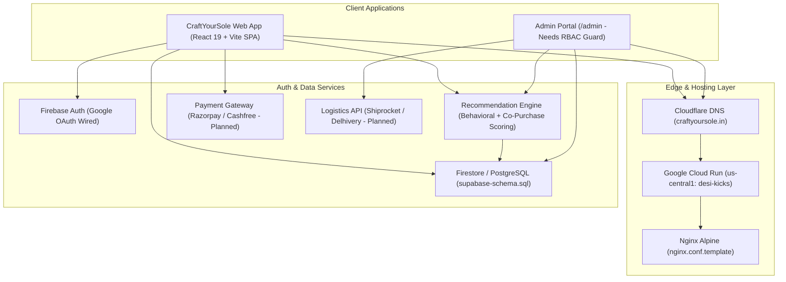

# 🗺 CraftYourSole: Production Roadmap & Functional Verification Tracker

This document tracks the architecture, implementation status, and **verifiable functional requirements** for evolving **CraftYourSole** (`https://craftyoursole.in`) from a pre-launch GCP Cloud Run preview into a full production D2C footwear platform.

---

## 📊 Roadmap Overview & Phase Status

| Phase | Focus Area | Completion | Target Milestone | Status |
|---|---|:---:|---|:---:|
| **Phase 1** | **Storefront, Rebrand, Routes & SEO Foundation** | **100%** | Pre-Launch | 🟢 Complete |
| **Phase 2** | **Backend Persistence, Auth Security & Payments** | **85%** | Launch Blocker | 🟡 In Progress |
| **Phase 3** | **Admin Dashboard & Inventory/Order Security** | **95%** | Launch Blocker | 🟢 Launch Ready |
| **Phase 4** | **Fulfillment, Logistics API & Customer Notifications** | **0%** | Post-Launch M1 | ⚪ Planned |
| **Phase 5** | **Scale, Automated Testing, CI/CD & Performance** | **65%** | Ongoing | 🟡 In Progress |

---

## 🏗 Current & Target Architecture

---

## ✅ Functional Requirements & Verification Matrix

Work through each `FR-*` item below in order before switching off `PreLaunchBanner` and opening public checkout. An item is **Pass** only when its verification steps succeed on the deployed `https://craftyoursole.in` environment.

### A. Storefront, Discovery & Content (`FR-01` – `FR-05`)

| ID | Requirement | Current State | Gaps / Work Required | How to Verify |
|---|---|---|---|---|
| **FR-01** | **Brand Identity & Visual Assets** | 🟡 Partial | ✅ `craftyoursole_logo.svg` & `favicon.svg` wired and unused starter assets (`react.svg`, `vite.svg`, `icons.svg`, `public/_redirects`) removed. Still verify dark-footer CSS invert visually and inspect unused `src/assets/hero.png` | Load `/` and `/collections` on desktop & mobile; confirm CraftYourSole logo, favicon, and zero `DESIKICKS` brand text in UI |
| **FR-02** | **Navigation & All Storefront Routes** | 🟢 Implemented | All 7 collection slugs (`/collections/*`), `/products/:slug`, `/about`, `/size-guide`, `/authenticity`, `/shipping-policy`, `/returns-exchange`, `/contact`, `/privacy-policy`, `/terms`, `/track-order`, and `*` 404 exist | Click every header nav item, category card, and footer link; verify zero dead links and unknown URLs render `NotFoundPage` |
| **FR-03** | **Search Bar & Collection Filtering** | 🟢 Implemented | ✅ `Navbar` and `MobileSearch` now filter live catalog (`useProductCatalog().activeProducts`). `CollectionsPage.tsx` now supports multi-attribute filtering (Indian Size `UK 6`–`UK 11`, In-Stock Only, and Sort by Price / Rating / Featured) plus empty catalog resilience. | Add a product in `/admin`, then search for it in header search and filter/sort on `/collections`. Confirm live match and sorting. |
| **FR-04** | **Product Detail, Size Selection & Reviews** | 🟡 Partial | Deep links, tabs, size guide, and reviews work via `localStorage`; pincode checker (`ProductDetailPage.tsx`) uses mock date math instead of real serviceability | Open `/products/royal-velvet-embroidered-mojari`, switch images, select UK size, check pincode, submit review, reload and verify persistence |
| **FR-05** | **Persistent Wishlist Across Views** | 🟢 Implemented | ✅ Implemented global `WishlistContext.tsx` persisted to `craftyoursole_wishlist`. Wired to all heart icons in `ProductCard`, `ProductDetailPage`, and `ProductDetailModal`. Badged in `Navbar` and `BottomNav` with direct navigation to `/profile?tab=wishlist`. `ProfilePage.tsx` renders real wishlisted items with "Move to Bag" and removal, and clean zero-state when empty. | Click heart on any product card, verify red counter on header and bottom nav, click badge to navigate to `/profile?tab=wishlist`, reload page, and verify persistence. Click "Move to Bag" to confirm cart addition and wishlist removal. |

### B. Authentication, Security & Access Control (`FR-06` – `FR-08`)

| ID | Requirement | Current State | Gaps / Work Required | How to Verify |
|---|---|---|---|---|
| **FR-06** | **Firebase Google Sign-In on Live Domain** | 🟡 Needs Live Check | `AuthContext.tsx` & `firebase.ts` wired; add `craftyoursole.in` and `www.craftyoursole.in` to Firebase Console → Authentication → Authorized Domains | Click Sign In on `https://craftyoursole.in/profile`, complete Google OAuth popup, reload and confirm session persists |
| **FR-07** | **Admin Portal Authentication & RBAC** | 🟢 Implemented | ✅ Implemented full RBAC access wall guarding `/admin` (`AdminPage.tsx`). Restricts access to authorized admins (`support@craftyoursole.in`, `admin@craftyoursole.in`, and `VITE_ADMIN_EMAILS`) via Google Sign-In or emergency `VITE_ADMIN_PASSCODE` unlock. Added session lock & sign out button. | Open `/admin` in Incognito: verify full-screen access wall blocks operations. Sign in with unauthorized user → Access Denied. Sign in with admin email or passcode → Portal unlocks. |
| **FR-08** | **Phone OTP Login (Optional for India COD)** | ⚪ Planned | Only Google Sign-In exists in `firebase.ts`; Phone OTP helps reduce COD fraud and friction for non-Google shoppers | Sign in with Indian mobile `+91` OTP and confirm session creation |

### C. Cart, Checkout & Payments (`FR-09` – `FR-12`)

| ID | Requirement | Current State | Gaps / Work Required | How to Verify |
|---|---|---|---|---|
| **FR-09** | **Cart Operations & Coupon Validation** | 🟢 Preview Ready | Add/remove items, update quantity/size, `FESTIVE500` & `SOLEFIRST` coupons, and `CartContext` `localStorage` sync work | Add product, change size/qty in `/cart`, apply `FESTIVE500`, reload page, verify totals match |
| **FR-10** | **Customer Address Form (Replace Demo Data)** | 🟢 Implemented | ✅ Replaced hardcoded Bengaluru demo address radio choices (`Indiranagar` / `Bellandur`) in `CartPage.tsx` with interactive, validated customer shipping address form (Full Name, 10-digit Phone with `+91`, Email, Street Address, City, State, 6-digit Indian PIN code). Pre-fills from user profile and persists to `craftyoursole_saved_address`. | Proceed to checkout in `/cart`: enter custom address, verify validation on empty or malformed fields, place order and verify real shipping address appears on confirmation screen and in order details. |
| **FR-11** | **Live Payment Gateway & Webhook Verification** | 🔴 **Launch Blocker** | Checkout is simulated pre-launch preview; integrate Razorpay / Cashfree order creation + signature/webhook verification + COD confirmation | Complete a Razorpay/Cashfree test transaction (`UPI` / `Card`) and verify order transitions to `PAID` only after verified callback |
| **FR-12** | **Stock Validation & Variant Deduction** | 🟢 Implemented | ✅ Added `checkStockAvailability` and `deductVariantStock` in `ProductContext.tsx`. Order placement now validates stock availability before placing and decrements variant stock automatically. In `ProductDetailPage.tsx`, fixed stock lookup (`0` fallback), disabled Add to Bag & Buy Now on out-of-stock sizes, and added visual "Out" badges. `ProductCard.tsx` now supports `stock` prop, disables quick-add when sold out, and shows "Sold Out" badge. | Set a size stock to `0` in `/admin` → Verify size button shows "Out", Add to Bag shows "Out of Stock" and is disabled on PDP. Order 2 pairs of in-stock footwear → Verify stock decrements by 2. |

### D. Backend Persistence & Operational Workflows (`FR-13` – `FR-15`)

| ID | Requirement | Current State | Gaps / Work Required | How to Verify |
|---|---|---|---|---|
| **FR-13** | **Real Database Persistence (Firestore or Supabase)** | 🟡 In Progress | ✅ Removed `INITIAL_ORDERS` mock array (Aarav, Priya, Rohan, Ananya) and purged legacy `desikicks_orders_store` storage keys; `OrderContext` now initializes with clean live data. Still needed: wire Firestore (`db` in `firebase.ts`) or Supabase (`supabase-schema.sql`) for cross-device sync | Create an order in Browser A (customer) and confirm it immediately appears in Browser B (`/admin` Orders tab) |
| **FR-14** | **Contact & Newsletter Form Delivery** | 🔴 Gap | `Footer.tsx` newsletter form and `ContactPage` form only show local UI confirmation without saving or sending email | Submit inquiry on `/contact` and email in footer; confirm record lands in Firestore/DB or sends notification to `support@craftyoursole.in` |
| **FR-15** | **Order Tracking & Fulfillment Updates** | 🟡 Partial | `/admin` updates order status in `localStorage`; `/track-order` is currently a placeholder lookup; wire order ID + phone/email lookup against real DB | Update order status to `Shipped` in `/admin`, then look up order ID on `/track-order` and `/profile` |

### E. SEO, Search Console & Cloud Deployment (`FR-16` – `FR-19`)

| ID | Requirement | Current State | Gaps / Work Required | How to Verify |
|---|---|---|---|---|
| **FR-16** | **Sitemap, Robots & Per-Route Metadata** | 🟢 Live Verified | `sitemap.xml` (23 URLs), `robots.txt`, `SeoHead.tsx` canonicals/JSON-LD, and `noindex` on `/cart`, `/profile`, `/admin`, `/track-order`, `*` are live | Check `https://craftyoursole.in/sitemap.xml` (`200 text/xml`), `robots.txt`, and run Google Search Console URL Inspection on `/`, `/collections/festive-ethnic`, `/products/royal-velvet-embroidered-mojari` |
| **FR-17** | **Rich Results & Social Previews** | 🟡 Needs Check | `Organization`, `WebSite`, `Product`, `CollectionPage`, and `BreadcrumbList` JSON-LD are injected | Validate live product URL in Google Rich Results Test and confirm `Product`, `Offer` (`INR`), and `BreadcrumbList` parse with zero errors |
| **FR-18** | **Cloud Build & Cloud Run Region Parity** | 🟡 In Progress | ✅ `cloudbuild.yaml` line 20 `--region` aligned to `us-central1` matching Cloud Run `desi-kicks`. Still needed: verify DNS mapping for `www.craftyoursole.in` in Cloudflare & GCP Console | Run Cloud Build pipeline and confirm container deploys directly to `us-central1`; verify `www.craftyoursole.in` resolves cleanly |
| **FR-19** | **Code Quality, Lint & Pre-Launch Removal** | 🟢 Lint Passing | ✅ `npm run lint` and `npm run build` both exit `0` cleanly (resolved `AuthContext.tsx` and React 19 hook purity checks). Launch-day action remaining: toggle `PreLaunchBanner` (`src/App.tsx`) and simulated checkout notices off | `npm run build` and `npm run lint` both exit `0` with zero warnings or errors |

### F. Personalized Recommendation System (`FR-20` – `FR-22`)

| ID | Requirement | Current State | Gaps / Work Required | How to Verify |
|---|---|---|---|---|
| **FR-20** | **Context-Aware "Best For You" & Recently Viewed (`Recommendations.tsx`)** | 🔴 Gap | `Recommendations.tsx` currently displays all `activeProducts` unranked; track recently viewed slugs, browsed categories, and preferred UK shoe size; rank in-stock matches first with best-seller (`totalSold`, `rating`) cold-start fallback | Browse 2 `Festive & Ethnic` products and select `UK 8`; return to `/` and verify `Recommendations` prioritizes in-stock `UK 8` Festive styles while an Incognito cold-start session shows top sellers |
| **FR-21** | **Smart Similar Styles & Cart Cross-Sell (`ProductDetailPage.tsx` & `CartPage.tsx`)** | 🔴 Gap | `relatedProducts` uses plain `.slice(0, 4)` without similarity scoring; `CartPage.tsx` only has one static spray upsell; score by category/occasion, price band, material/artisan hub, and co-purchased accessories | Open `/products/handcrafted-heritage-penny-loafer` and confirm similar formal/daily leather styles rank above running shoes; add footwear to `/cart` and verify relevant cross-sell add-ons appear |
| **FR-22** | **Interaction Telemetry, Co-Purchase Scoring & Admin Boosting (`AdminPage.tsx`)** | ⚪ Planned | Log `product_view`, `add_to_cart`, `wishlist_add`, and `purchase` events to Firestore/Analytics; compute "Customers also bought" pairs and add Admin pin/boost controls + CTR metrics | Complete a view → cart → order test flow; verify event logs update co-purchase weights and an Admin-pinned SKU moves to slot 1 on `/` |

### G. Admin Catalog CRUD, Inventory, Model Analytics & Maintenance Mode (`FR-23` – `FR-26`)

| ID | Requirement | Current State | Gaps / Work Required | How to Verify |
|---|---|---|---|---|
| **FR-23** | **Full Product CRUD: Add, Update & Delete (`AdminPage.tsx`)** | 🟢 Implemented | ✅ Implemented full interactive Edit Product Modal (`isEditModalOpen`) wired to `updateProduct` in `ProductContext.tsx`. Supports editing title, price, MRP, category, tag, image URL, artisan origin, materials, story, and UK 6–11 inventory matrix. Removed mock sample image pickers and fixed broken preview fallback. | In `/admin` Product Catalog: click Edit on any footwear, update its price and stock counts, submit and confirm live changes reflect on storefront and admin table; delete and confirm removal. |
| **FR-24** | **Per-Size Inventory Management & Stock Alerts (`AdminPage.tsx`)** | 🟢 Implemented | ✅ Built real-time low-stock detection engine (dynamically flags all variants with `<= 5` pairs in stock across catalog). Integrated per-UK-size inventory adjustment inside Edit Product Modal and wired automatic stock decrement upon customer order checkout (`FR-12`). | Set `UK 8` stock to `<= 5` in Edit modal; verify low-stock alert highlights `UK 8` with remaining pair count; place an order in storefront and verify stock decrements accordingly. |
| **FR-25** | **Shoe Model-Wise Analysis (`AdminPage.tsx`)** | 🟢 Implemented | ✅ Trailing 7-day GMV bar chart connected to live customer order telemetry. Dynamic footwear category breakdown % based on live sales and catalog SKUs. Inventory Buffer KPI card tracking total pairs and variant health. Top-selling footwear table wired to live `productSales` (units sold, stock status, gross sales). | Open `/admin` → Sales & Analytics tab; verify 7-day revenue trajectory, category share bars, inventory buffer status, and top-selling model rankings reflect live store operations. |
| **FR-26** | **Storefront Maintenance Mode (`App.tsx` & `AdminPage.tsx`)** | 🔴 Gap | No maintenance mode toggle or screen exists; add backend-persisted `maintenanceMode` config (enabled toggle, custom message, ETA) controllable from `/admin`; block customer routes (`/` , `/collections/*`, `/products/*`, `/cart`, `/profile`) while keeping `/admin` accessible and emitting `noindex, nofollow` (and `503` + `Retry-After` at edge/Nginx when planned) so Google Search Console does not drop indexed URLs | Toggle Maintenance Mode ON in `/admin`; open `https://craftyoursole.in` in Incognito and verify maintenance screen renders with `noindex`, while `/admin` remains accessible to turn it back OFF |

### H. Media Storage, Order Lifecycle, Merchandising & Observability (`FR-27` – `FR-30`)

| ID | Requirement | Current State | Gaps / Work Required | How to Verify |
|---|---|---|---|---|
| **FR-27** | **Product Media Upload & Self-Hosted Imagery (`AdminPage.tsx` & `firebase.ts`)** | 🔴 Gap | `AdminPage.tsx` only accepts image URL text and storefront uses external Unsplash / `lh3.googleusercontent.com` links (`images.ts`, `ProductContext.tsx`); wire multi-image upload to Firebase Storage (`storage`) / Cloud Storage with WebP/AVIF optimization | Upload primary + gallery images via `/admin`, create/edit product, and confirm images load from your own CDN/Storage bucket |
| **FR-28** | **Order Cancellation, Returns & GST Tax Invoicing (`ProfilePage.tsx` & `OrderContext.tsx`)** | 🟡 Partial | ✅ `DK-` → `CYS-` prefix fixed in `OrderContext.tsx`, `CartPage.tsx`, `ProfilePage.tsx`. Still needed: customer cancel button before `SHIPPED`, self-serve 7-day size exchange form, downloadable GST invoice (HSN `6403`/`6404`/`6405`, 5%/18% footwear GST split) | Cancel a `PENDING` order in `/profile`, request a size exchange on a `DELIVERED` order, download its GST invoice PDF, and verify `CYS-` order numbering |
| **FR-29** | **Coupon CMS & Unwired UI Cleanup (`AdminPage.tsx`, `Navbar.tsx`, `CartPage.tsx`)** | 🔴 Gap | Coupons (`FESTIVE500`, `SOLEFIRST`) are hardcoded in `CartPage.tsx`; `photo_camera` icon in `Navbar.tsx` / `MobileSearch.tsx` has no click handler; `search.ts` contains 3 items missing from `ProductContext.tsx` | Create/disable a coupon in `/admin` and verify it in `/cart`; confirm no unwired buttons exist in desktop or mobile search |
| **FR-30** | **Secrets Hygiene & Production Analytics (`Dockerfile`, `.env.example`, `firebase.ts`)** | 🟡 In Progress | ✅ `.env.example` rebranded to CraftYourSole. ✅ Removed hardcoded `lohithkumarshoemart` Firebase `ARG` defaults from `Dockerfile`. Still needed: track GA4 e-commerce events (`view_item`, `add_to_cart`, `begin_checkout`, `purchase`) + error logging | Verify production container builds with CraftYourSole env vars (zero hardcoded fallback secrets in `Dockerfile`) and GA4/Cloud Logging receives test funnel events |

### I. Nike-Benchmark Storefront, Fit Confidence & Custom Craft Features (`FR-31` – `FR-35`)

| ID | Requirement | Current State | Gaps / Work Required | How to Verify |
|---|---|---|---|---|
| **FR-31** | **Colorway Swatches & Hover Image Swap (`ProductContext.tsx`, `ProductCard.tsx`)** | 🔴 Gap | Each `Product` currently stores a single image/colorway and `variants` only tracks `{ size, stock }`; extend product model with `colorways` (`name`, `hex`, `img`, `additionalImages`, per-color `variants`), render swatch selectors on `ProductCard.tsx` and `ProductDetailPage.tsx`, and swap to secondary/on-foot angle on card hover | Hover over a card on `/collections` to verify secondary angle preview; click a colorway swatch on card & PDP and confirm image and per-color UK size stock update |
| **FR-32** | **Aggregated Fit Meter Above Size Picker (`ProductDetailPage.tsx`)** | 🔴 Gap | Reviews already capture `fitFeedback` (`Runs Small`, `True to Size`, `Runs Large`), but no summary meter appears near the UK size grid; compute aggregate fit score from `reviews` and display a visual fit slider bar right above size selection | Open `/products/royal-velvet-embroidered-mojari`, submit a `Runs Small` review, and confirm the fit meter above the UK size buttons shifts accordingly |
| **FR-33** | **"Craft Your Sole" Customizations (`ProductDetailPage.tsx`, `CartPage.tsx`)** | ⚪ Planned | No shoe personalization options exist yet; add selectable craft options per model (e.g., *Standard vs. Wide Indian Fit*, *Extra 6mm Ortho Arch Insole*, *Custom Wedding Dust-Bag Monogram*) carried into `CartItem` and order line items | Select Wide Fit + Ortho Insole + Monogram on PDP, add to bag, confirm selections & surcharge show in `/cart` and saved order details |
| **FR-34** | **Out-of-Stock "Notify Me" & Drop Waitlist (`ProductDetailPage.tsx`)** | ⚪ Planned | Out-of-stock sizes lack demand capture; allow shoppers to click an out-of-stock UK size (or upcoming drop) and submit email/WhatsApp for instant restock notification persisted to Firestore/DB | Select an out-of-stock UK size (`stock === 0`), enter email in "Notify Me", and confirm waitlist entry persists in DB & appears in `/admin` demand report |
| **FR-35** | **Fast Guest Checkout & In-Stock UK Size Filter (`CartPage.tsx`, `CollectionsPage.tsx`)** | 🔴 Gap | `CartPage.tsx` relies on logged-in/hardcoded demo addresses, and `CollectionsPage.tsx` only has category pills; support frictionless Guest Checkout (name, phone, email, address) alongside Google Sign-In, plus multi-select filters on `/collections` for in-stock UK size, color, price range, and sort | Open `/collections` in Incognito, filter by `UK 8` + `Price: Low to High`, add an item, and complete Guest Checkout without signing in |

### J. Full-App Codebase Audit Fixes, Security Headers & Performance (`FR-36` – `FR-38`)

| ID | Requirement | Current State | Gaps / Work Required | How to Verify |
|---|---|---|---|---|
| **FR-36** | **Cart State Integrity & Launch Defaults (`CartContext.tsx`, `CartPage.tsx`, `ProductCard.tsx`)** | 🟢 Implemented | ✅ Default cart is clean empty `[]` (`INITIAL_CART`); `CartItem.id` standardized to `${productId}-${size}` across Card, Quick View modal, and PDP; `addToCart` & `updateSize` automatically merge duplicate rows; coupons default to `null` with dynamic percent calculation; simulated order receipt uses dynamic delivery date & selected address | Clear `localStorage`, open `/cart` → empty bag; add identical model + size from Card, Quick View, and PDP → merges into single line item with true `productId` |
| **FR-37** | **Profile Live Sync & Dead Controls Cleanup (`ProfilePage.tsx`, `BottomNav.tsx`)** | 🔴 Gap | Orders tile hardcodes `3` instead of `orders.length` and shows global mock orders to any visitor; `Track Live Delivery`, `Size Exchange or Return`, `Download Invoice`, `+ Add New Address`, `Edit`, and `Use Coins On Next Order` have no handlers; `Account Settings` uses uncontrolled `defaultValue` inputs (`Arjun Sharma`) that discard edits; `BottomNav` Wishlist opens default Orders tab instead of `?tab=wishlist` | Sign in, open `/profile`, verify every button performs its action (or hides when inapplicable), edit Settings + reload to confirm persistence, tap mobile `Wishlist` tab → opens Wishlist directly |
| **FR-38** | **Edge Security Headers & Bundle Splitting (`nginx.conf.template`, `vite.config.ts`, `App.tsx`)** | 🟢 Implemented | ✅ Security headers (`CSP`, `HSTS`, `X-Frame-Options`, `X-Content-Type-Options`, `Referrer-Policy`, `Permissions-Policy`) live in `nginx.conf.template`. ✅ Lazy-loaded `/admin` (`React.lazy` + `Suspense`) and split vendor chunks (`vendor-firebase`, `vendor-react`, `vendor-router`) in `vite.config.ts`. Main JS chunk decreased from `1,058.97 kB` down to `225.90 kB` (78% drop) with zero chunk warnings | Run `npm run build` with zero >500 kB chunk warnings, deploy to Cloud Run, and verify security headers via `curl -I https://craftyoursole.in` |

---

## 🎯 Phase Breakdown

### Phase 1: Customer Web App — Storefront, Routes & SEO
- [x] **Responsive Layout & Navigation**: Sticky header with `craftyoursole_logo.svg`, bottom mobile tab bar (`BottomNav`), and mobile search bar.
- [x] **Pre-Launch Preview Banner**: `PreLaunchBanner` in `src/App.tsx` communicating active pre-launch status.
- [x] **Hero Carousel, Categories, Recommendations & New Arrivals**: All wired to `/collections` and `/collections/:slug`.
- [x] **Dedicated Storefront & Policy Routes**: `/collections`, `/collections/:slug`, `/products/:slug`, `/about`, `/size-guide`, `/authenticity`, `/shipping-policy`, `/returns-exchange`, `/contact`, `/track-order`, `/privacy-policy`, `/terms`, and `*` 404.
- [x] **SEO Metadata & Sitemap Pipeline**: `SeoHead.tsx`, `scripts/generate-sitemap.mjs` (`prebuild`), `public/sitemap.xml` (23 URLs), `public/robots.txt`, and `nginx.conf.template` cache rules.
- [ ] **Unified Live Search & Collection Filters (`FR-03`, `FR-35`)**: Connect `Navbar` / `MobileSearch` to `ProductContext` instead of static `ALL_PRODUCTS`, and add in-stock UK size, colorway, price range, and sort filters on `CollectionsPage`.
- [ ] **Colorway Swatches, Hover Angles & Fit Meter (`FR-31`, `FR-32`)**: Group colorways per product model with swatch selectors on `ProductCard` / `ProductDetailPage`, secondary-image hover swap, and aggregated `Runs Small / True to Size / Runs Large` bar above the UK size picker.
- [ ] **"Craft Your Sole" Personalization & Waitlist (`FR-33`, `FR-34`)**: Support Wide/Standard fit, Ortho Arch Insole, and monogram options, plus per-size "Notify Me" restock capture.
- [ ] **Synced Wishlist Context (`FR-05`)**: Replace ephemeral heart toggles in `ProductCard` / `ProductDetailPage` with persistent `WishlistContext` synced to `ProfilePage`.
- [ ] **Client-Side Recommendation Scoring (`FR-20`, `FR-21`)**: Add recently-viewed history, preferred UK size weighting, multi-attribute similarity scoring on `/products/:slug`, and dynamic cross-sell recommendations in `/cart`.

### Phase 2: Backend Services, Auth Security & Payments
- [x] **Firebase SDK & Google Sign-In (`src/lib/firebase.ts`, `AuthContext.tsx`)**: Google OAuth popup and auth listener implemented.
- [x] **Schema Reference (`supabase-schema.sql`)**: Relational schema drafted for PostgreSQL/Supabase option.
- [ ] **Production Data Store Wiring**: Connect `ProductContext`, `OrderContext`, `CartContext`, user addresses, and `ContactPage` / newsletter submissions to Firestore (or Supabase).
- [ ] **Recommendation Event Pipeline (`FR-22`)**: Persist `product_view`, `add_to_cart`, and `purchase` co-occurrence weights in Firestore/DB for collaborative ("Customers also bought") ranking.
- [ ] **Admin RBAC Protection**: Gate `/admin` behind Firebase Auth custom claims or admin allowlist + Firestore/backend security rules.
- [ ] **Customer Address Book & Guest Checkout (`FR-10`, `FR-35`)**: Replace hardcoded sample Bengaluru addresses in `CartPage.tsx` and `ProfilePage.tsx`, and support both Guest Checkout and signed-in saved addresses.
- [ ] **Razorpay / Cashfree Payment Integration**: Live UPI/Card/NetBanking checkout + idempotent webhook verification + stock deduction.
- [ ] **Live Pincode Serviceability**: Replace simulated delivery date calculation in `ProductDetailPage.tsx` with courier pincode API.

### Phase 3: Admin Dashboard (Sales Monitoring & Operations)
- [x] **KPI Metric Cards & Visual Analytics**: GMV, orders, AOV, pipeline counts, category breakdown, and top 5 preview (`AdminPage.tsx`).
- [x] **Zero-Mock Operational Engine**: Purged all mock orders (Aarav, Priya, Rohan, Ananya); trailing 7-day revenue trajectory, category share from orders, active catalog health, and variant low-stock alerts dynamically computed from live state.
- [/] **Product Catalog Table & CRUD (`FR-23`)**: Add (`addProduct`), delete (`deleteProduct`), and live/draft toggle (`toggleProductStatus`) work; **missing Edit/Update modal** wired to `updateProduct`.
- [x] **Order Management Hub**: Filter orders by status and advance fulfillment states (`Pending` → `Packing` → `Shipped` → `Delivered`), with order clearing action.
- [/] **Per-Size Inventory Management & Stock Alerts (`FR-24`)**: Live variant low-stock detection engine implemented (`stock <= 5`); still needed: inline per-size stock editor in Catalog table and stock deduction on checkout (`FR-12`).
- [/] **Shoe Model-Wise Analysis (`FR-25`)**: Per-model order performance table with units sold, gross sales, and total stock connected to live orders; still needed: CSV export and date range selector.
- [ ] **Storefront Maintenance Mode (`FR-26`)**: Admin toggle + scheduled window + SEO-safe (`noindex` / `503 Retry-After`) maintenance page while keeping `/admin` reachable.
- [ ] **Real-Time Multi-User Sync**: Back admin reads/writes with live Firestore/Supabase queries instead of browser `localStorage`.
- [ ] **Bulk Actions & GST Invoices**: Bulk price/tag updates and printable GST-compliant invoices/packing slips.
- [ ] **Merchandising & Recommendation Boost Controls (`FR-22`)**: Pin featured drops in `AdminPage.tsx` and monitor recommendation click-through & add-to-cart conversion rates.

### Phase 4: Fulfillment, Logistics & Customer Notifications
- [ ] **Shiprocket / Delhivery Integration**: Automated AWB generation and tracking webhook updates.
- [ ] **Live `/track-order` Lookup**: Query real order & courier tracking milestones by Order ID + phone/email.
- [ ] **WhatsApp / Email Transactional Alerts**: Automated confirmations via `support@craftyoursole.in` / WhatsApp Business API.
- [ ] **Self-Serve 7-Day Size Exchange Portal**: Automated reverse pickup scheduling from `/returns-exchange` and `/profile`.

### Phase 5: Scale, Verification, CI/CD & Testing
- [x] **Docker + Nginx Cloud Run Container**: `Dockerfile` + `nginx.conf.template` deployed on GCP Cloud Run (`craftyoursole.in`).
- [x] **Fix `cloudbuild.yaml` Region & Automated CI**: Aligned `--region` to `us-central1` matching Cloud Run instance.
- [x] **Resolve Existing Lint Errors**: Cleaned up ESLint / React 19 hook purity errors in `AuthContext.tsx` and `CartPage.tsx`; `npm run lint` exits `0`.
- [ ] **Automated Test Suite**: Add Vitest unit tests (cart/coupon/stock calculations) and Playwright E2E smoke tests covering every `FR-*` requirement above.
- [x] **Core Web Vitals & Bundle Splitting (`FR-38`)**: Split vendor chunks (`vite.config.ts`) and lazy-load `/admin`, reducing customer main bundle from `1,058 kB` to `225 kB` (78% drop).

---

## 📋 Launch-Readiness Order of Execution

1. **DevOps, Secrets & Domain Parity (`FR-18`, `FR-06`, `FR-30`, `FR-38`)**:
   - Align `cloudbuild.yaml` `--region` with your mapped Cloud Run service (`us-central1`), map `www.craftyoursole.in` in Cloud Run + Cloudflare, remove hardcoded Firebase `ARG` defaults from `Dockerfile`, add `craftyoursole.in` / `www.craftyoursole.in` to Firebase Authorized Domains, and split vendor chunks / lazy-load `/admin`.
2. **Backend, Admin CRUD & Inventory Blockers (`FR-07`, `FR-10`, `FR-12`, `FR-13`, `FR-14`, `FR-23`, `FR-24`, `FR-26`, `FR-27`)**:
   - Guard `/admin`, wire `updateProduct` Edit UI, per-size Inventory Management, colorway data schema (`FR-31`), and media upload (`storage`), add Storefront Maintenance Mode, replace `localStorage` mocks, `INITIAL_ORDERS`, and hardcoded addresses with Firestore/Supabase, implement real stock validation + deduction (fixing `currentStock || 10` on zero-stock sizes), and persist contact/newsletter/restock-waitlist (`FR-34`) submissions.
3. **Live Payments, Model Analytics, Conversion UX & Recommendations (`FR-03`, `FR-05`, `FR-11`, `FR-15`, `FR-20`–`FR-22`, `FR-25`, `FR-28`, `FR-29`, `FR-31`–`FR-37`)**:
   - Integrate Razorpay/Cashfree sandbox → production keys with Guest Checkout (`FR-35`), fix `CartContext`/`CartPage` launch defaults + SKU IDs (`FR-36`), wire `/profile` dead controls & live user data (`FR-37`), unify search + in-stock UK size filters on `/collections`, add colorway swatches + hover swap + fit meter + CraftYourSole customizations, sync wishlists, wire `/track-order` + customer cancellations/exchanges + GST invoices, add Coupon CMS, build Shoe Model-Wise Analysis, and implement behavioral + co-purchase recommendations.
4. **Final Verification & Public Go-Live (`FR-16`, `FR-17`, `FR-19`, `FR-30`, `FR-38`)**:
   - Pass all `FR-01`–`FR-38` checks, verify GA4 funnel + error telemetry, fix `AuthContext.tsx` lint errors, verify Rich Results + live Nginx security headers + Google Search Console coverage, and remove `PreLaunchBanner` and demo-checkout notices.
