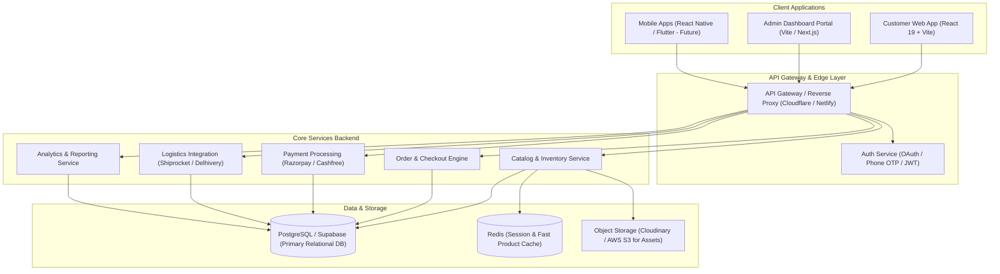

# 🗺 Desi-Kicks: Production-Grade Roadmap & Progress Tracker

This document outlines the strategic roadmap, architecture plan, and live implementation progress for evolving **Desi-Kicks** from a high-fidelity frontend prototype into a production-grade, enterprise-ready D2C e-commerce platform and operational back-office.

---

## 📊 Roadmap Overview & Phase Status

| Phase | Focus Area | Completion | Target Milestone | Status |
|---|---|:---:|---|:---:|
| **Phase 1** | **Customer Web App (Storefront & Core UX)** | **75%** | M1 2026 | 🟡 In Progress |
| **Phase 2** | **Backend Services, Database & Payments** | **20%** | M2 2026 | 🟡 In Progress |
| **Phase 3** | **Admin Dashboard (Sales & Catalog Ops)** | **10%** | M3 2026 | 🔵 Next Focus |
| **Phase 4** | **Fulfillment, Logistics & Logistics API** | **0%** | M4 2026 | ⚪ Planned |
| **Phase 5** | **Scale, Security, Analytics & Mobile Apps** | **0%** | M5 2026 | ⚪ Planned |

---

## 🏗 High-Level Architecture Target

---

## 🎯 Phase 1: Customer Web App — Storefront & Experience

**Objective**: Deliver a blisteringly fast, responsive, mobile-first shopping experience tailored for Indian footwear shoppers.

### 1.1 Storefront & Browsing
- [x] **Responsive Layout & Navigation**: Sticky desktop header, bottom mobile tab bar (`BottomNav`), search overlay.
- [x] **Hero Carousel**: Promotional banners with auto-play, pause on hover, and CTA links.
- [x] **Curated Category Grid**: Quick access to Mojaris, Slip-ons, Heels, Sneakers, and Kolhapuris.
- [x] **Product Recommendations**: Curated shelves with smart contextual badges (*Festive Edit*, *Daily Comfort*, *Women's Pick*).
- [x] **New Arrivals Section**: Grid view displaying pricing, original MRP, and savings percentage.
- [x] **Trust & Assurance Badges**: Free delivery thresholds, return guarantees, artisan quality assurance.
- [/] **Search & Faceted Filters**:
  - [x] Static keyword suggestions & trending terms in mobile/desktop search.
  - [ ] Debounced real-time search with instant dropdown results.
  - [ ] Facet filters on collection pages (Filter by Price range, Size UK 6-11, Occasion, Material, Color).
  - [ ] Sorting mechanisms (Price: Low to High, High to Low, Most Popular, Newest First).

### 1.2 Product Details & Engagement
- [x] **Interactive Product Modal**: Instant quick-view modal without page reloads.
- [x] **Multi-Image Showcase**: High-res product angles and lifestyle imagery.
- [x] **Artisan Story & Technical Specs**: Detailed sections for Upper Material, Sole, Insole memory foam, and Ideal Occasions.
- [x] **Size Picker & Validation**: Clear UK size selection with availability feedback.
- [ ] **Dedicated Product Detail Pages (`/products/:slug`)**: Direct deep links with OpenGraph meta tags for social sharing.
- [ ] **Customer Reviews & Visual UGC**:
  - [ ] Customer photo/video uploads with review submissions.
  - [ ] "Verified Buyer" badge system.
  - [ ] Rating breakdown (5-star distribution chart).
- [ ] **Interactive Size Guide**: Foot measurement diagram (in cm/inches) to eliminate size confusion and return rates.
- [ ] **Wishlist System**: Heart toggle to save items to personal wishlist with persistent sync.

### 1.3 Shopping Bag & Checkout Flow
- [x] **Persistent Shopping Cart (`CartContext`)**: Automatic sync with `localStorage`.
- [x] **Dynamic Pricing & Bill Breakdown**: Live calculations of MRP, discounts, free shipping eligibility, and final total.
- [x] **Promotional Coupon Engine**: Instant validation for coupon codes (`FESTIVE20`, `DIWALI500`, `WELCOME10`).
- [x] **In-Cart Size & Quantity Adjustments**: Change sizes or quantities directly inside the cart summary.
- [ ] **Multi-Step Checkout Flow**:
  1. Delivery Address (Pincode auto-lookup for Indian postal codes, city/state auto-fill).
  2. Shipping Method (Standard Free vs. Express Priority).
  3. Payment Options (UPI QR / Intent, Cards, NetBanking, Cash on Delivery).
  4. Order Confirmation page with confetti, order ID, and printable receipt.
- [ ] **Abandoned Cart Recovery**: Local state reminder banner for returned shoppers.

---

## 🔐 Phase 2: Backend Services, Database & Payments

**Objective**: Replace mock frontend fixtures with resilient, scalable APIs, relational database models, and payment integrations.

### 2.1 Database & Data Modeling (PostgreSQL + Prisma)
- [ ] **Schema Definition**:
  - `users`: ID, phone, email, name, role (`CUSTOMER`, `ADMIN`, `FULFILLMENT`), timestamps.
  - `addresses`: User reference, street, locality, city, state, pincode, is_default.
  - `products`: SKU, title, slug, description, artisan_story, base_price, mrp, category, tags, active.
  - `product_variants`: Product reference, size (UK 6-11), color, sku_code, stock_quantity, price_override.
  - `product_images`: Variant/product reference, image_url, alt_text, sort_order.
  - `orders`: User ID, total_amount, discount_amount, shipping_fee, payment_status, order_status, shipping_address.
  - `order_items`: Order reference, variant reference, quantity, unit_price.
  - `coupons`: Code, discount_type (`PERCENT` / `FLAT`), value, min_order_value, max_discount, expiry_date, usage_limit.
- [ ] **Migrations & Seeders**: Automated database seed scripts for initial footwear catalog.

### 2.2 Authentication & User Management
- [ ] **Phone Number OTP Login** (via Twilio / MSG91 / Firebase Auth) – critical for Indian e-commerce conversion.
- [ ] **Social Authentication**: Google One-Tap & Sign in with Apple.
- [ ] **JWT Session Handling & Refresh Tokens**: Secure, HttpOnly cookie storage.
- [ ] **Role-Based Access Control (RBAC)**: Enforced middleware separating customer endpoints from admin endpoints.

### 2.3 Payment Gateway Integration (India-First)
- [ ] **Razorpay / Cashfree Gateway**:
  - Instant UPI Intent (Google Pay, PhonePe, Paytm, CRED).
  - Credit & Debit Cards (RuPay, Visa, Mastercard) with tokenization compliance.
  - NetBanking across top Indian banks.
  - Cash on Delivery (COD) with optional OTP verification to prevent fake orders.
- [ ] **Webhook Handlers**: Idempotent webhook listener for `payment.captured`, `payment.failed`, and `refund.processed`.
- [ ] **Refund Automation**: Instant or standard refund processing for cancelled or returned orders.

---

## 🖥 Phase 3: Admin Dashboard (Sales Monitoring & Operations)

**Objective**: Build a unified management portal for store owners and operations teams to monitor real-time sales, fulfill orders, manage inventory, and add/update products.

### 3.1 Executive Sales & Business Analytics
- [ ] **Real-Time KPI Metric Cards**:
  - **Gross Merchandise Value (GMV)** (Today, This Week, This Month, All Time).
  - **Net Revenue** (after returns, discounts, and cancellations).
  - **Average Order Value (AOV)** & Units Per Transaction (UPT).
  - **Total Orders & Conversion Rate** (% of visits converting to checkout).
- [ ] **Interactive Visual Analytics**:
  - Revenue timeline charts (interactive day/month views with festive season overlays).
  - Category revenue distribution (Pie / Donut charts: Mojaris vs. Loafers vs. Heels).
  - Payment method breakdown (UPI % vs. COD % vs. Cards).
  - Heatmap of orders by Indian State & Top Metro Pincodes (Mumbai, Delhi-NCR, Bangalore, Jaipur, etc.).
- [ ] **Exportable Reports**: Generate CSV / Excel reports for accounting and GST filing.

### 3.2 Product & Catalog Information Management (PIM)
- [ ] **Product Catalog Data Table**:
  - Searchable, filterable list of all footwear items.
  - Quick inline toggle for Active/Inactive status.
  - Column indicators for Category, Current Stock, MRP, Selling Price, and Sales Count.
- [ ] **"Add New Product" Wizard**:
  - **Basic Info**: Title, URL slug, category selector, festive tag badges.
  - **Artisan & Heritage Details**: Artisan story narrative, region of craft (e.g., Jaipur, Agra, Kolhapur).
  - **Material & Craft Specs**: Upper material, sole construction, insole cushioning specs, care guide.
  - **Variant Matrix Generator**: Automatically generate UK 6 to UK 11 SKU rows with independent stock quantities.
  - **Media Uploader**: Drag-and-drop multi-image uploader with Cloudinary / S3 integration, image cropping, and thumbnail reordering.
- [ ] **Bulk Product Actions**: Batch price updates, bulk tagging, and CSV product import.

### 3.3 Order & Fulfillment Management
- [ ] **Order Management Hub**:
  - Kanban board or tabbed data table: `All`, `Pending Verification`, `Ready to Pack`, `Dispatched`, `Delivered`, `Cancelled/Returned`.
  - Color-coded badges for payment status (`Paid via UPI`, `COD Pending`, `Refunded`).
- [ ] **Order Detail View**:
  - Customer contact information and verified delivery address.
  - Ordered footwear sizes, variants, and quantities.
  - Timeline of status transitions with audit log.
- [ ] **Fulfillment Actions**:
  - Single-click invoice generation (GST compliant with tax breakup).
  - Packing slip & thermal shipping label printing.

### 3.4 Inventory & Stock Control
- [ ] **Live Inventory Tracking**: Unified stock count across all sizes and colorways.
- [ ] **Low Stock Alerts**: Configurable alerts when an SKU drops below threshold (e.g. fewer than 5 pairs left).
- [ ] **Backorder / Pre-Order Toggle**: Option to accept festive pre-orders when handcrafting is in progress.

### 3.5 Marketing, Discounts & Banner Management
- [ ] **Coupon Manager**: Create and deactivate coupon codes with constraints (e.g., valid until Diwali, minimum cart value ₹2,499).
- [ ] **Site Announcement Bar CMS**: Update the top promotional announcement banner directly from the dashboard without redeploying code.

---

## 📦 Phase 4: Fulfillment, Logistics & Logistics API

**Objective**: Connect Desi-Kicks directly with top Indian e-commerce logistics aggregators.

- [ ] **Logistics Aggregator Integration**:
  - Direct integration with **Shiprocket** / **Delhivery** / **Bluedart** APIs.
  - Automated Air Waybill (AWB) number assignment on order confirmation.
- [ ] **Automated Serviceability & COD Verification**:
  - Check courier serviceability by pincode during checkout.
  - Real-time estimated delivery date calculation (e.g., "Arriving by Thursday, Oct 24").
- [ ] **Customer Notifications**:
  - Automated WhatsApp Business notifications for order confirmation, dispatch, and out-for-delivery.
  - SMS tracking links with live courier milestone tracking.
- [ ] **Return & Exchange Portal**:
  - Self-service customer return request page (e.g., "Size too small, exchange for UK 10").
  - Automated reverse-pickup generation upon admin approval.

---

## ⚡ Phase 5: Scale, Security, Performance & Mobile

**Objective**: Guarantee high reliability during festive traffic spikes (Diwali, Wedding Season, Eid) and expand to native mobile.

- [ ] **Performance & Web Vitals**:
  - Next-gen image optimization (AVIF/WebP formats with responsive `srcset`).
  - Code splitting and lazy loading of modals and route chunks.
  - Sub-second Core Web Vitals (LCP < 1.8s, CLS < 0.05).
- [ ] **SEO & Discoverability**:
  - Server-Side Rendering (SSR) / Static Site Generation (SSG).
  - Structured Data (`schema.org/Product`, `AggregateRating`, `Offer`) for Google rich search results.
  - XML sitemap generation and canonical link headers.
- [ ] **Security & Compliance**:
  - Rate limiting on checkout, OTP, and search endpoints.
  - PCI-DSS compliant checkout flow (no card data touches internal servers).
  - Indian DPDP Act (Digital Personal Data Protection) compliance for user data privacy.
- [ ] **Automated Testing Suite**:
  - Unit & Integration tests for cart calculations, coupon logic, and stock deduction (Vitest).
  - End-to-end (E2E) checkout and order journey tests (Playwright).
  - Continuous Integration (CI) GitHub Actions pipeline.
- [ ] **Native Mobile Apps**:
  - Cross-platform React Native or Flutter mobile app reusing the backend REST/GraphQL API.

---

## 📋 Immediate Action Items (Sprint Board)

The following priority tasks are queued for implementation:

1. **Sprint 1 (Now)**:
   - [ ] Establish dedicated Product Detail Pages (`/product/:id`) with persistent shareable URLs.
   - [ ] Build search results and category filter interface with sorting options.
   - [ ] Complete the checkout form modal / page with address validation.

2. **Sprint 2 (Next)**:
   - [ ] Scaffold the Admin Dashboard layout with responsive sidebar and navigation.
   - [ ] Implement the Analytics Overview page with mock & real metrics (GMV, AOV, Orders).
   - [ ] Implement the Product Catalog Management screen with "Add Product" modal and SKU generator.

3. **Sprint 3**:
   - [ ] Connect PostgreSQL database with Prisma ORM.
   - [ ] Implement Razorpay sandbox payment gateway with UPI support.
   - [ ] Link order creation flow between Customer Web App and Admin Dashboard.

---

*This roadmap is actively maintained and updated with every release sprint. To propose new features or adjust priorities, create an issue or pull request.*

