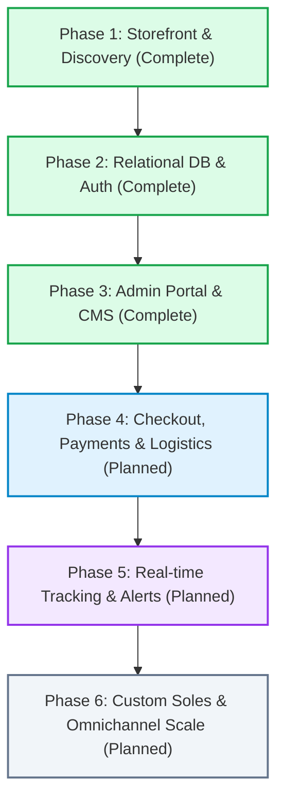

# 🗺️ Desi-Kicks / CraftYourSole — Product & Technical Roadmap

> **Target Release:** Q1/Q2 2026  
> **Repository:** `Desi-Kicks`  
> **Brand Identity:** CraftYourSole (`craftyoursole.in`)  
> **Status:** Pre-Launch Beta / Production Readiness Stage  

---

## 📌 Executive Summary

**Desi-Kicks** unites centuries-old Indian footwear artistry (Amritsar royal mojaris, Agra handcrafted leather formals, Kolhapuri chappals) with 21st-century ergonomic shoe mechanics (dual-density orthopedic memory foam, shock-absorbing EVA, breathable AirKnit meshes).

This document outlines the strategic product vision, technical architecture milestones, functional requirements traceability, and delivery timeline across six structured phases—from initial prototype to omnichannel enterprise scale.

---

## 🚦 Status Legend

| Status Icon | Meaning | Definition |
| :---: | :--- | :--- |
| ✅ | **Completed** | Production-ready, verified in code, passing lint and typecheck. |
| 🚧 | **In Progress** | Active development underway or integration pending. |
| 📋 | **Planned** | Scoped, prioritized, scheduled for subsequent sprint waves. |
| ⚠️ | **Launch Blocker** | Critical prerequisite before accepting live public transactions. |

---

## 🧭 Phased Delivery Plan

---

## 📅 Detailed Phase Breakdown

### Phase 1: Core Storefront, Responsive Art Direction & Discovery
*Goal: Provide a lightning-fast, visually captivating customer experience celebrating Indian artisanal footwear.*

- [x] **Infinite Hero Slider (`Hero.tsx`)**:
  - Touch-swipe gestures for mobile and mouse-drag for desktop.
  - Dual-orientation `<picture>` art direction (16:9 widescreen desktop & 9:16 portrait mobile).
  - Virtual cloned slides for seamless, continuous looping with no visual snapback.
  - Hover/touch pause controls and indicator dots.
- [x] **Gender Selection Cards (`GenderSelection.tsx`)**:
  - 3-column curated poster grid in 4:5 aspect ratio for Men, Women, and Kids collections.
  - Studio photography, hover scale effects, and direct collection routing.
- [x] **Algorithmic Best Sellers Shelf (`BestSellers.tsx`, `bestSellerAlgorithm.ts`)**:
  - Objective 4-pillar scoring algorithm weighing sales volume (45%), Bayesian rating confidence (25%), variant stock availability (15%), and merchant boosts (15%).
  - Horizontal drag/snap carousel with card pricing and size badges.
- [x] **Men's Collection Showcase (`MenCollectionShowcase.tsx`)**:
  - Dedicated promotional slider for men's retro casuals and street footwear.
  - Category quick-filter carousel for Casual Wear, Rain Ready, Slides, Sports, and Formals.
- [x] **Women's Collection Showcase (`WomensCollection.tsx`)**:
  - "Nature in Every Step" editorial ribbon banner and curated pastel slides showcase.
- [x] **Multi-Faceted Collections Catalog (`CollectionsPage.tsx`)**:
  - Subcategory filtering, target gender selector, UK size matrix, in-stock toggle, and price brackets.
  - Sorting by Featured, Price Low-to-High, Price High-to-Low, and Rating.
- [x] **Product Detail Experience (`ProductDetailModal.tsx`, `ProductDetailPage.tsx`)**:
  - Quick-view modal and standalone deep-linkable URLs (`/products/:slug`).
  - 5-angle image gallery with thumbnail preview.
  - Interactive UK 1 to UK 12 sizing selector with real-time stock alerts.
  - Material breakdown (upper, sole, insole) and artisan heritage stories.
- [x] **Storefront Policy & Information Pages (`StorefrontInfoPages.tsx`)**:
  - Authentic Craftsmanship, Size & Fit Guide, Shipping Policy, Returns & Exchange, Privacy Policy, Terms of Service, and About Us.
- [x] **Search & Navigation (`Navbar.tsx`, `MobileSearch.tsx`, `BottomNav.tsx`)**:
  - Autocomplete search with trending suggestions.
  - Mobile bottom navigation bar for thumb-friendly mobile browsing.
- [x] **Automated XML Sitemap (`scripts/generate-sitemap.mjs`)**:
  - Dynamic generation during `prebuild` ensuring high SEO search indexability.

---

### Phase 2: Full-Stack Persistence, Auth & Relational Catalog (✅ Completed)
*Goal: Establish robust database schemas, secure authentication, and offline-first client resilience.*

- [x] **Supabase PostgreSQL Relational Schema (`supabase-schema.sql`)**:
  - `products`: Catalog items, pricing, specs, tags, and multi-angle image arrays.
  - `product_variants`: Granular stock inventory per shoe size with cascade foreign keys.
  - `orders`: Structured order records with JSONB items and shipping addresses.
  - `coupons`: Promotional discount rules and minimum order values.
  - `hero_slides` & `returns_exchanges`: Tables for banner CMS and self-serve size exchange requests.
  - `product-images`: Public Supabase Storage bucket with upload policies.
- [x] **Catalog Read Queries (`getProductsFromSupabase` in `supabase.ts`)**:
  - Hydrates active products and variant sizes into the customer storefront on mount.
- [x] **Catalog Mutations Sync to Supabase (`ProductContext.tsx`, `supabase.ts`)**:
  - `createProductInSupabase`, `updateProductInSupabase`, `deleteProductInSupabase`, and `toggleProductStatusInSupabase` write directly to Supabase `products` and `product_variants`.
- [x] **Real-Time Variant Stock Decrement in Database (`ProductContext.tsx`, `supabase.ts`)**:
  - On checkout, `deductVariantStockInSupabase` decrements size variant stock in `product_variants` and increments `total_sold` on `products` in Supabase.
- [x] **Initial Order Insertion & Status Updates (`saveOrderToSupabase`, `updateOrderStatusInSupabase`)**:
  - Asynchronously writes customer order records to Supabase `orders` table and syncs admin status updates.
- [x] **Multi-Device Order History Sync (`OrderContext.tsx`, `ProfilePage.tsx`)**:
  - Customer orders are fetched from Supabase by `customer_email` upon authentication, ensuring order histories are synced across all devices.
- [x] **Live Coupon Validation Engine (`CartPage.tsx`, `supabase.ts`)**:
  - Connects `validateCouponInSupabase()` and `getActiveCouponsFromSupabase()` to live database promos with fallback rules.
- [x] **Self-Serve Size Exchange Sync (`ProfilePage.tsx`, `supabase.ts`)**:
  - Customer size exchange requests are inserted into the Supabase `returns_exchanges` table.
- [x] **Firebase Google Authentication (`AuthContext.tsx`, `LoginPage.tsx`)**:
  - Google OAuth popup flow with persistent session storage.
- [x] **Cart & Pricing Engine (`CartContext.tsx`)**:
  - Persistent cart state, dynamic MRP calculations, free delivery threshold (₹1,999+), and shoe care kit add-on.
- [x] **Offline-First Client Fallback**:
  - Graceful fallback to `localStorage` and curated catalog mocks if database connection is interrupted.

---

### Phase 3: Admin Operations Portal & Merchandising CMS (✅ Completed)
*Goal: Empower store managers with full catalog, order fulfillment, merchandising, and customer service control.*

#### ✅ Completed in Phase 3:
- [x] **Executive Analytics Dashboard (`DashboardSection.tsx`)**:
  - Gross Merchandise Value (GMV), Total Orders, Average Order Value (AOV), and Pipeline Counts.
  - Trailing 7-day revenue visualization, category sales distribution, and top-selling SKUs.
- [x] **Admin Navigation & Sub-Routes (`AdminPage.tsx`, `AdminSidebar.tsx`)**:
  - Modular sub-routing: `/admin/dashboard`, `/admin/catalog`, `/admin/orders`, `/admin/returns`, `/admin/coupons`, `/admin/banners`.
- [x] **Full Product Catalog UI & Forms (`CatalogSection.tsx`, `ProductFormModal.tsx`)**:
  - Add, edit, and soft-delete product modals with 5-angle image gallery preview.
  - Configurable taxonomy categories, subcategories, gender, artisan region, and material specs.
- [x] **Per-Size Inventory Manager UI (`SizeInventoryManager.tsx`)**:
  - Individual stock quantities across UK 1 to UK 12.
  - Visual low-stock alert badges (`stock <= 5`) and quick gender presets (Men UK 6-12, Women UK 3-8, Kids UK 1-5).
- [x] **Direct Image Uploads (`ImageUploadField.tsx`)**:
  - Drag-and-drop file upload directly to Supabase Storage (`product-images`) with automatic public URL generation.
- [x] **Admin Order Status Updates to Database (`OrdersSection.tsx`, `OrderContext.tsx`, `supabase.ts`)**:
  - Advancing orders from Pending → Packing → Shipped → Delivered directly executes update queries in Supabase.
- [x] **Order Fulfillment UI Workflow (`OrdersSection.tsx`)**:
  - Order state lifecycle transitions (`Pending` → `Packing` → `Shipped` → `Delivered`), order search, and simulated test data.
- [x] **Cloud Persistence for Hero Banners (`BannersSection.tsx`, `HeroContext.tsx`, `supabase.ts`)**:
  - Add, edit, activate/deactivate, and reorder homepage hero slides with desktop & mobile asset URLs.
  - Backed by Supabase `hero_slides` table with client fallback for multi-user synchronization.
- [x] **Coupons CMS in Admin (`CouponsSection.tsx`, `supabase.ts`, `CartPage.tsx`)**:
  - Create, view, search, and toggle active status for percentage and flat discount promo codes.
  - Real-time synchronization with Supabase `coupons` table and live storefront validation in `CartPage.tsx`.
- [x] **Size Exchange Admin Queue (`ReturnsSection.tsx`, `ProfilePage.tsx`, `supabase.ts`)**:
  - Full queue displaying customer size exchange requests submitted from `ProfilePage.tsx` under the 36-hour exchange-only policy.
  - Step-by-step return state pipeline (`REQUESTED` → `APPROVED` → `SCHEDULED_PICKUP` → `IN_TRANSIT` → `REPLACED_DELIVERED` / `REJECTED`).
  - Storefront enforces strict Exchange-Only policy with zero monetary returns/refunds.
- [x] **Storefront Maintenance Mode Switch (`AdminHeader.tsx`, `AdminPage.tsx`, `MaintenanceScreen.tsx`, `App.tsx`)**:
  - Instant one-click toggle in Admin header to lock customer storefront during catalog restocking or upgrades.
  - Displays a high-converting, branded maintenance announcement with customer support contacts and admin bypass link.
- [x] **Admin Authentication Guard (`AdminLoginPage.tsx`, `AdminPage.tsx`)**:
  - Configurable credentials via environment variables (`VITE_ADMIN_USER`, `VITE_ADMIN_PASSWORD`), persistent session tokens, and route protection.

---

### Phase 4: Headless Checkout, Payment Gateway & Shiprocket Logistics
*Goal: Convert high-intent customer traffic into completed transactions with seamless Indian logistics.*

- [ ] ⚠️ **Shiprocket Headless Checkout Integration (`FR-11`)**:
  - Replace simulation in `CartPage.tsx` with 1-click checkout powered by Shiprocket Headless Checkout.
  - Instant mobile OTP verification and pre-filled address intelligence across 200M+ Indian online shoppers.
  - Native support for UPI Intent (GPay, PhonePe, Paytm), Credit/Debit Cards, NetBanking, and verified COD.
- [ ] ⚠️ **Webhook Verification & Serverless Payment Confirmation (`FR-10`)**:
  - Edge/Serverless function to verify payment signatures before confirming orders in the Supabase `orders` table.
- [ ] ⚠️ **Shiprocket Pincode Serviceability & Delivery SLA Query (`FR-04`)**:
  - Dynamic API query to check courier reachability across 19,000+ Indian pincodes.
  - Display exact estimated delivery turnaround (e.g., "Delivery by Tuesday, 24th Nov") replacing mock date math.
- [ ] ⚠️ **Shiprocket Automated Fulfillment API (`FR-15`)**:
  - Trigger automated Air Waybill (AWB) generation upon transitioning order to `Packing`/`Shipped` in Admin.
  - Multi-courier auto-allocation (BlueDart, Delhivery, DTDC, Xpressbees) based on lowest cost and highest delivery speed.
  - Automated shipping label & GST invoice PDF download directly from Admin.
- [ ] **Contact & Newsletter Form Persistence (`FR-14`)**:
  - Wire `/contact` form and footer newsletter input to store inquiries in Supabase or send transactional emails to `support@craftyoursole.in`.
- [ ] **Storefront Maintenance Mode Switch (`FR-26`)**:
  - Add an instant toggle in `/admin` backed by `VITE_MAINTENANCE_MODE` to gracefully hold customer traffic during catalog overhauls.
- [ ] **Coupons CMS in Admin (`FR-29`)**:
  - Dedicated tab in Admin to add, modify, and expire promotional coupon codes in the Supabase `coupons` table.

---

### Phase 5: Customer Notifications, Real-Time Tracking & Engagement
*Goal: Maximize customer post-purchase delight, minimize return-to-origin (RTO), and build brand community.*

- [ ] **Automated WhatsApp & SMS Updates (`FR-16`)**:
  - Real-time WhatsApp notifications via Shiprocket Engage / Twilio on order confirmation, dispatch, out-for-delivery, and successful delivery.
  - 1-click address confirmation to reduce COD Return-to-Origin (RTO).
- [ ] **Live Public Order Tracking (`/track-order`)**:
  - Direct live query against Shiprocket tracking webhooks using Order Number + Phone/Email.
  - Interactive multi-stop progress tracker (Order Placed → Picked Up → In Transit → Out for Delivery → Delivered).
- [ ] **Verified Customer Review & Photo Upload Engine (`FR-30`)**:
  - Post-delivery email/WhatsApp invite for customers to submit star ratings, fit reviews, and photos of their shoes.
  - Supabase table `product_reviews` with admin moderation before public display.
- [ ] **Customer Wishlist Cloud Synchronization**:
  - Upgrade `WishlistContext` from `localStorage` to sync with Supabase authenticated user profiles.
  - "Back in Stock" notification triggers when a favorited out-of-stock size is replenished in Admin.

---

### Phase 6: Customization Studio, 3D Soles & Omnichannel Scale
*Goal: Deliver on the brand promise of "CraftYourSole" with bespoke personalization and offline presence.*

- [ ] **"Craft Your Sole" Interactive 3D Customizer (`FR-35`)**:
  - WebGL / Three.js 3D shoe visualizer allowing customers to customize upper leather tones, thread embroidery patterns, sole materials, and personalized heel debossing.
  - Real-time custom price calculation and production queue tracking for Agra & Jaipur artisan workshops.
- [ ] **Algorithmic Foot Sizing Scanner (`FR-36`)**:
  - Camera-guided A4 sheet foot scanning tool within the browser to recommend exact UK sizing and wide/narrow fit suitability.
- [ ] **Omnichannel POS & Pop-up Store Integration (`FR-37`)**:
  - Unified inventory sync between online warehouse and offline retail pop-ups / trunk shows.
- [ ] **B2B Bulk & Corporate Gifting Portal**:
  - Dedicated wholesale inquiry flow for wedding party bulk orders, royal velvet sherwani sets, and corporate gifting.

---

## 🎯 Immediate Launch Blockers & Action Checklist

Before launching the storefront to the public, the following 7 action items must be completed:

| # | Action Item | Priority | Target Files / Scope | Deliverable |
| :-: | :--- | :---: | :--- | :--- |
| **1** | **Shiprocket 1-Click Checkout & UPI Integration** | 🚨 P0 | `src/routes/CartPage.tsx`, `src/lib/shiprocket.ts` | Complete payment processing and address pre-fill |
| **2** | **Payment Webhook Verification** | 🚨 P0 | Serverless function / Supabase Edge Functions | Verified transaction callbacks before order confirmation |
| **3** | **Live Pincode Serviceability Check** | 🚨 P1 | `src/routes/CartPage.tsx`, `src/routes/ProductDetailPage.tsx` | Real-time SLA delivery dates based on entered PIN |
| **4** | **Admin Shiprocket AWB Generation** | 🚨 P1 | `src/routes/admin/OrdersSection.tsx` | 1-click shipping label and AWB creation in Admin |
| **5** | **Contact & Newsletter Form Persistence** | ⚠️ P2 | `src/routes/StorefrontInfoPages.tsx`, `src/components/Footer.tsx` | Store customer messages in database |
| **6** | **Coupons Management Tab in Admin** | ⚠️ P2 | `src/routes/AdminPage.tsx`, `src/routes/admin/` | Visual UI to create and disable discount codes |
| **7** | **Storefront Maintenance Mode Toggle** | ⚠️ P2 | `src/routes/admin/AdminHeader.tsx`, `src/App.tsx` | Quick kill-switch for storefront during updates |

---

## 🧪 Technical Debt & Engineering Milestones

### 1. Automated Testing Suite
- [ ] **Unit Tests (Vitest)**:
  - Objective Best Seller scoring algorithm edge cases (`bestSellerAlgorithm.test.ts`).
  - Cart dynamic pricing, discount thresholds, and coupon validation (`CartContext.test.tsx`).
  - Variant stock deduction logic (`ProductContext.test.tsx`).
- [ ] **Component Integration Tests**:
  - Infinite hero swipe gesture handling.
  - Sizing selector state transitions and out-of-stock disabling.
- [ ] **End-to-End Smoke Tests (Playwright)**:
  - Complete customer checkout flow from homepage search to order confirmation.
  - Admin login, product creation, stock adjustment, and order state transition.

### 2. Security & RLS Lockdown
- [ ] Replace demo permissive Supabase RLS policies with strict JWT role validation (`auth.role() = 'admin'` or authenticated service role).
- [ ] Secure admin credentials with hashed backend tokens rather than client-evaluated environment variables.

### 3. Performance & Asset Delivery
- [ ] Migrate local photography in `src/assets/hero/` to a globally distributed Image CDN (Cloudinary / Supabase Image Transformation) with automatic AVIF/WebP generation and responsive `srcset`.
- [ ] Implement Redis / Edge caching for public catalog queries.

---

## 📊 Functional Requirements Traceability Matrix

| Requirement ID | Description | Module / File | Current Status |
| :--- | :--- | :--- | :---: |
| **FR-01** | Dual-orientation infinite hero slider | `Hero.tsx`, `HeroContext.tsx` | ✅ Completed |
| **FR-02** | 3-column gender poster selection | `GenderSelection.tsx` | ✅ Completed |
| **FR-03** | Algorithmic best sellers shelf | `BestSellers.tsx`, `bestSellerAlgorithm.ts` | ✅ Completed |
| **FR-04** | Pincode serviceability & courier SLA | `CartPage.tsx` | 🚧 In Progress |
| **FR-05** | Men's collection promotional showcase | `MenCollectionShowcase.tsx` | ✅ Completed |
| **FR-06** | Women's floral showcase | `WomensCollection.tsx` | ✅ Completed |
| **FR-07** | Admin credential authentication | `AdminLoginPage.tsx`, `AdminPage.tsx` | ✅ Completed |
| **FR-08** | Multi-faceted collections filtering | `CollectionsPage.tsx` | ✅ Completed |
| **FR-09** | UK 1–12 variant sizing matrix | `ProductDetailModal.tsx`, `ProductDetailPage.tsx` | ✅ Completed |
| **FR-10** | Secure customer address capture | `CartPage.tsx`, `supabase-schema.sql` | ✅ Completed |
| **FR-11** | Shiprocket 1-click headless checkout | `CartPage.tsx` | 🚧 In Progress |
| **FR-12** | Printable GST tax invoices | `ProfilePage.tsx` | ✅ Completed |
| **FR-13** | Self-serve customer size exchange | `ProfilePage.tsx` | ✅ Completed |
| **FR-14** | Contact & newsletter persistence | `StorefrontInfoPages.tsx`, `Footer.tsx` | 📋 Planned |
| **FR-15** | Automated Shiprocket AWB fulfillment | `OrdersSection.tsx` | 🚧 In Progress |
| **FR-16** | WhatsApp & SMS dispatch notifications | Third-party webhook / backend | 📋 Planned |
| **FR-23** | Product catalog CRUD management | `CatalogSection.tsx`, `ProductFormModal.tsx` | ✅ Completed |
| **FR-24** | Per-size variant inventory management | `SizeInventoryManager.tsx` | ✅ Completed |
| **FR-25** | Executive analytics & revenue charts | `DashboardSection.tsx` | ✅ Completed |
| **FR-26** | Storefront maintenance mode switch | `AdminPage.tsx`, `App.tsx` | 📋 Planned |
| **FR-27** | Direct image upload to Supabase bucket | `ImageUploadField.tsx` | ✅ Completed |
| **FR-28** | Hero banner CMS management | `BannersSection.tsx`, `BannerFormModal.tsx` | ✅ Completed |
| **FR-29** | Coupons & promotions CMS in Admin | `AdminPage.tsx` | 📋 Planned |
| **FR-30** | Verified customer photo reviews | `productReviews.ts`, Supabase | 📋 Planned |
| **FR-35** | "Craft Your Sole" 3D shoe visualizer | Future module | 📋 Planned |
| **FR-38** | Rollup code-splitting & Web Vitals | `vite.config.ts`, `App.tsx` | ✅ Completed |
